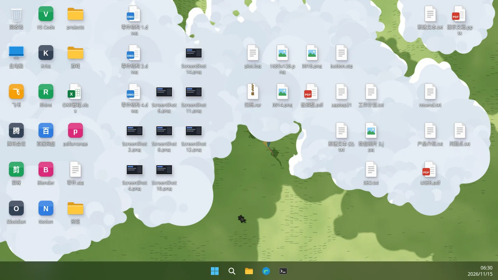
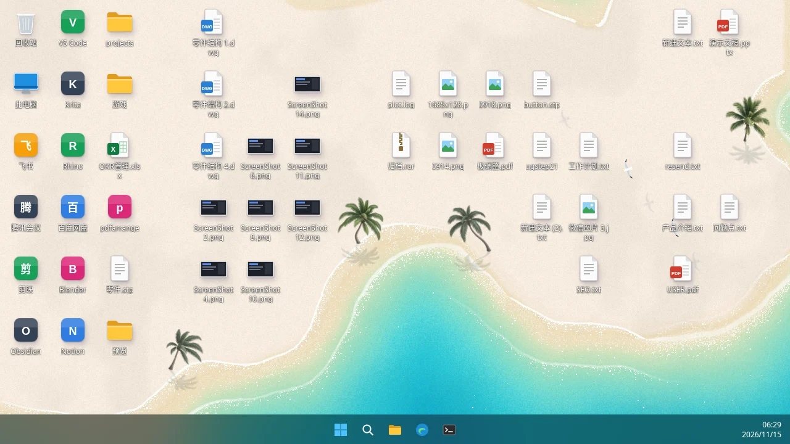

# DiyarDesk

**Adaptive desktop wallpaper that makes your desktop icons part of the scenery.**

DiyarDesk turns the space around your desktop icons into a living interactive landscape on **Linux** (KDE Plasma 6, X11, wlroots Wayland) and **Windows**. Move, add, or remove an icon and dunes, clouds, foliage, ripples, or glowing horizons reshape smoothly around it — locally in real time, without AI, cloud accounts, or telemetry.

> **Upstream attribution:** DiyarDesk is an independent community fork based on [Deskland](https://deskland.app) (`GPL-3.0`), using its own product name (**DiyarDesk**) and original icon, with no official affiliation or endorsement from upstream Deskland. See [NOTICE](NOTICE) and [TRADEMARKS.md](TRADEMARKS.md).

**English** · [简体中文](#中文说明) · [Features](#features) · [Linux Setup](#linux-setup) · [Windows Build](#windows-build) · [Credits & License](#credits-and-license)





## Included themes

DiyarDesk includes **11 complete adaptive/animated themes** plus custom theme import (`.zip`, `.deskland`, single `.html`, images, and videos):

- **Meadow** (`meadow.html`) — ink-and-wash grass, icon-hugging clouds and shadows, kite boy, black cat
- **Beach** (`flat.html`) — shoreline waves, kayaks, seabirds, coconut palms
- **Aurora** (`aurora.html`) — top-down frozen fjord, ice shimmer, aurora glow, pines and lanterns
- **Polar Night** (`polarnight.html`) — side-view winter horizon, triple aurora curtains, snow-forest clearing, shore cabin
- **Sahara** (`desert.html`) — overhead desert dunes with raised sand hills beneath icons, date-palm oases, Bedouin tents, camels, travelers
- **Glade** (`glade.html`), **Rift** (`rift.html`), **Strike** (`strike.html`), **Pocket** (`pocket.html`), **Roach** (`roach.html`), **Rosebrook** (`rosebrook.html`)

## Features

- **Adaptive scenery:** tracks live desktop icon positions (KDE Plasma `IconSpy`, GVfs/Xfce, or Windows Shell) and updates smoothly when icons move.
- **Custom theme importer:** import `.zip`/`.deskland` theme packs, standalone `.html` shaders/pages, images, or looping videos directly from Settings (`+ Import theme…`).
- **Desktop integration:** system tray menu, session autostart, and automatic pause when a foreground window is maximized or fullscreen.
- **Private sharing:** snapshots and animation exports render sample icons cleanly without exposing your personal files or desktop names.
- **English and Simplified Chinese:** lightweight offline settings UI with no accounts, store APIs, or auto-updater endpoints.

## Linux Setup

### Requirements

- Python `>= 3.10`, `python3-gi`, `python3-gi-cairo`, GTK 3 (`gir1.2-gtk-3.0`), WebKit2GTK (`gir1.2-webkit2-4.1` or `4.0`), AppIndicator3 (`gir1.2-ayatanaappindicator3-0.1`).
- Optional: `gir1.2-gtklayershell-0.1` (Sway/Hyprland), `xdotool` (X11 fullscreen detection), KDE Plasma 6 WebEngine/IconSpy plugins (`linux/plasma-wallpaper/`, `linux/kde-iconspy/`).

### Run from source

```bash
./linux/run.sh
```

Unit tests (`pytest`):

```bash
PYTHONPATH=linux uv run --with pytest pytest -v linux/tests
```

User settings, imported themes, custom audio files, and logs are stored in `~/.config/deskland/`.

## Browser preview

```bash
node prototype/serve.mjs
```

Open **http://localhost:5178/settings.html** (`?lang=en` for English). Browser preview uses sample icons; real desktop icon tracking runs under the Linux or Windows host.

## Windows Build

Open PowerShell in the repository root:

```powershell
powershell -ExecutionPolicy Bypass -File host\build.ps1
host\bin\Deskland.exe
```

To build the NSIS installer (`dist/`):

```powershell
powershell -ExecutionPolicy Bypass -File tools\build-installer.ps1
```

## Project layout

| Path | Contents |
| --- | --- |
| `linux/deskland_linux/` | Modular Python Linux host, tray, fullscreen pause, icon readers, custom theme importer |
| `linux/plasma-wallpaper/` | KDE Plasma 6 native WebEngine wallpaper plugin |
| `linux/kde-iconspy/` | KDE Plasma companion helper for live desktop icon coordinates |
| `linux/packaging/` | Desktop entry, original DiyarDesk SVG icon, `.deb` and Arch `PKGBUILD` scripts |
| `host/` | Windows C#/WinForms/WebView2 host and build scripts |
| `prototype/` | Shared themes, settings UI (`settings.html`), i18n JSONs (`en`, `zh-CN`), sharing script, assets |
| `tools/` | Version metadata and Windows NSIS installer scripts |

## Credits and license

Source code and included theme assets are licensed under [GPL-3.0](LICENSE). Third-party dependencies retain their own licenses; see [THIRD_PARTY_NOTICES.md](THIRD_PARTY_NOTICES.md), [NOTICE](NOTICE), and [TRADEMARKS.md](TRADEMARKS.md).

---

## 中文说明

[English](#diyardesk) · **简体中文**

**让桌面图标成为风景的一部分。**

**DiyarDesk** 是一款支持 **Linux**（KDE Plasma 6、X11、wlroots Wayland）与 **Windows** 的自适应动态壁纸程序。移动、添加或删除桌面图标时，沙丘、云影、草木与光影会实时围绕图标变化；全部本地演算，无需 AI、账号或联网服务。

> **上游声明：** DiyarDesk 是基于开源项目 [Deskland](https://deskland.app)（`GPL-3.0`）的独立分支，使用独立的名称（**DiyarDesk**）与原创图标，与上游 Deskland 无官方隶属或背书关系。详见 [NOTICE](NOTICE) 与 [TRADEMARKS.md](TRADEMARKS.md)。

### 已内置主题与扩展导入

内置 **11 套完整动态壁纸主题**（草地、沙滩、极光、极夜、撒哈拉沙漠、林间空地、裂隙、惊雷、口袋桌面、互动甲虫、玫瑰溪），并支持通过设置窗口右上角「导入主题…」导入自定义 `.zip` / `.deskland` 主题包、单页 `.html`、静态图片和循环视频。

### 快速运行（Linux / 浏览器预览）

```bash
# Linux 桌面宿主直接运行
./linux/run.sh

# 运行 Python 单元测试
PYTHONPATH=linux uv run --with pytest pytest -v linux/tests

# 浏览器预览设置界面
node prototype/serve.mjs
# 访问 http://localhost:5178/settings.html
```

用户配置、已导入自定义主题、音频与日志保存在 `~/.config/deskland/`。

### Windows 源码构建

```powershell
powershell -ExecutionPolicy Bypass -File host\build.ps1
host\bin\Deskland.exe
```

### 许可说明

项目源码和随附主题素材按 [GPL-3.0](LICENSE) 发布；第三方依赖版权见 [THIRD_PARTY_NOTICES.md](THIRD_PARTY_NOTICES.md)。名称与图标规范见 [TRADEMARKS.md](TRADEMARKS.md)。
